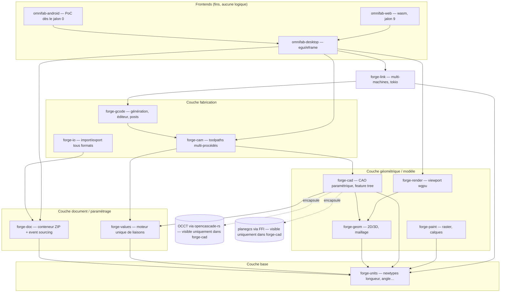

# Architecture du workspace OmniFab

> Schéma cible des crates et de leurs dépendances, conforme aux ADR-0000 à 0004 (validés 2026-10-11). Ce document est un **garde-fou** : toute frontière ne change que par ADR. Les crates sont créées à leur jalon (noyau minimal au jalon 0) ; celles non encore créées sont en italique dans le texte ci-dessous.

## Vue en couches

## Règles de dépendances (invariants)

1. **forge-units ne dépend de rien** du noyau ; toute crate métier dépend d'elle (ADR-0000, verrou 5).
2. **OCCT et planegcs sont invisibles hors de forge-cad** (ADR-0004) : le reste du workspace ne connaît que le modèle de géométrie forge-cad en types forge-units.
3. **Toute liaison paramétrique passe par forge-values** (ADR-0000, verrou 6) : alias/expressions et éditeur nodal sont deux vues du même graphe.
4. **forge-doc est la seule à toucher l'archive projet** (ADR-0001) : journal `events.jl` JSON Lines, version de schéma par type d'événement, snapshots non autoritaires, migrations `v_n → v_n+1` testées en CI.
5. **forge-link ne parle qu'en G-code et états machine** : tokio + canaux vers l'UI (ADR-0000, verrou 4) ; un freeze de l'UI ne coupe jamais le pilotage.
6. **Feature flags `native`/`wasm`** dans chaque crate ; aucun accès natif hors trait d'abstraction (règles plateforme, ADR-0000).
7. **Erreurs** : enums thiserror par domaine, codes stables `OF-<DOM>-<NNNN>` enregistrés dans `docs/error-codes.md` (ADR-0003) ; anyhow interdit dans le noyau.

## Noyau minimal livré au jalon 0

- `forge-units`, `forge-doc`, `forge-values` (compilables, testées, rustdoc complet)
- `omnifab-desktop` : app de démonstration egui (fenêtre + viewport vide + journal d'événements affiché)
- `omnifab-android` : preuve de concept (tactile, clavier virtuel, cycle de vie de l'activité)
- Les autres crates sont créées à leur jalon, avec rustdoc et feature flags dès leur création.

## Assistants de conception guidée

**Pas une crate** : les assistants sont des templates déclaratifs versionnés (formulaire + règles + valeurs normées par secteur) exécutés au-dessus de forge-values / forge-cad / forge-cam / forge-io. Premier assistant : meuble/caisson (jalon 10, référence comportementale PolyBoard).
