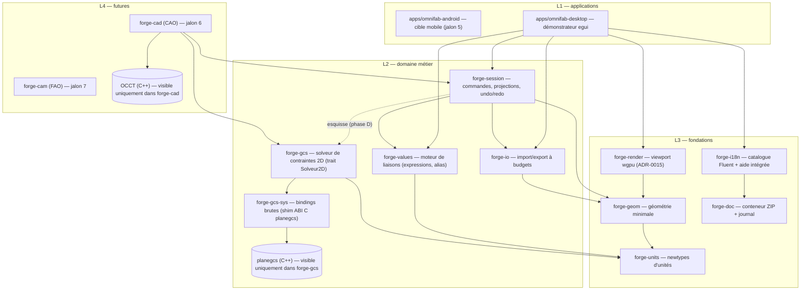
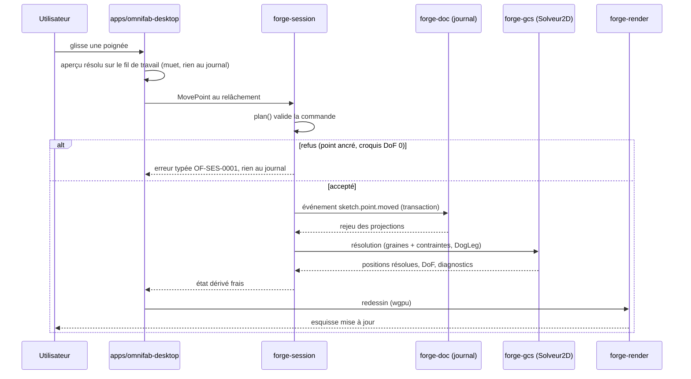
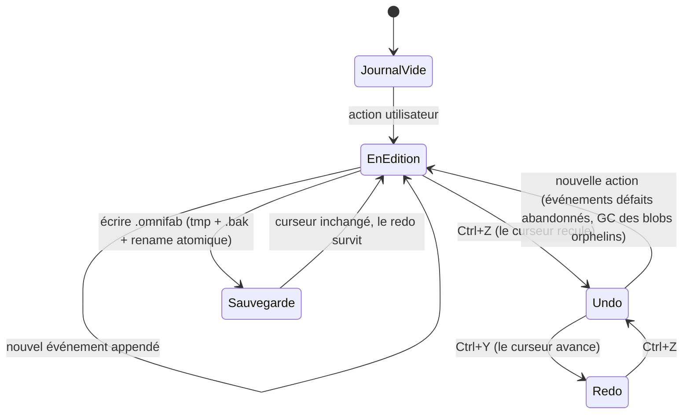
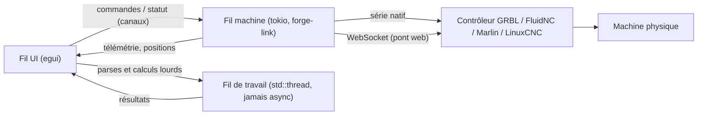

# Architecture des crates

Schéma de dépendances du noyau : chaque crate ne voit que ses
dépendances directes, jamais au-delà (garde-fou de la phase 0, ADR-0000 ;
frontières mises à jour par l'ADR-0013 (solveur de contraintes) et
par l'ADR-0015 (viewport wgpu).

Règles de frontière (phase 0, complétées par l'ADR-0013) :

1. Le journal des événements et le conteneur ZIP appartiennent à
   forge-doc ; personne d'autre ne touche aux octets.
2. OCCT et planegcs sont des dépendances C++ **enfermées** : OCCT est
   invisible hors de forge-cad (ADR-0004), planegcs est invisible hors
   de forge-gcs (ADR-0013) — la frontière visible du projet est le trait
   `Solveur2D`. `forge-gcs-sys` (bindings brutes) et le shim
   `third_party/planegcs-shim` ne sont consommés que par `forge-gcs`.
3. forge-values est la **seule** source d'évaluation des expressions ;
   forge-cad (jalon 6) l'appellera pour le paramétrage, et pilotera les
   cotes de forge-gcs par ses expressions (phase E).
4. L'affichage passe par les messages Fluent de forge-i18n : pas de
   chaîne visible en dur dans le noyau.
5. Les unités ne circulent jamais en `f64` nu : newtypes de forge-units
   à la frontière de chaque crate (forge-gcs réintroduit les newtypes
   au-dessus de l'ABI C, qui parle en `double`).
6. Événements et blobs suivent le schéma de forge-doc (ADR-0001) : les
   gros objets (géométrie importée) vivent dans des blobs référencés,
   jamais dans le journal.

Licences des crates : GPL-3.0-or-later à la racine, MPL-2.0 pour les
crates isolées ; forge-gcs, forge-gcs-sys et le shim sont en
LGPL-2.1-or-later (héritage planegcs, ADR-0013) — compatibles avec la
GPL du dépôt ; les crates MPL-2.0 n'en dépendent pas.

Vendoring : `third_party/planegcs` est un sous-module git figé, décrit
par `third_party/planegcs-MANIFEST.md` (ADR-0013) ; son contenu n'est
jamais modifié localement.

# Schémas d'interaction

Trois schémas complètent le graphe de dépendances : ils décrivent des
**invariants** (comportements garantis par les ADR), pas un état
momentané du code. Toute évolution qui casse un de ces schémas doit
passer par un ADR ou mettre le schéma à jour dans la même PR.

## Un geste utilisateur : du clic à l'écran

Trajet complet d'une action (ex. déplacer un point de l'esquisse,
ADR-0018/0021). Rien n'atteint le journal sans validation au `plan()` ;
les positions résolues ne sont jamais sérialisées (résoudre = état
dérivé).

## Undo/redo et sauvegarde (event sourcing, ADR-0008)

Le journal est la seule vérité : l'undo ne fait que reculer un curseur
en mémoire ; la sauvegarde est atomique (tmp + .bak + rename) et ne
casse pas le redo (ADR-0016-A2/C3).

## Chaîne machine : l'UI ne gèle jamais le pilotage (verrou n°4, cible)

Cible des jalons 4+ (forge-link, forge-gcode) : les traitements longs
et le pilotage vivent hors du fil d'interface, reliés par des canaux.
Règle d'or : un freeze de l'UI ne coupe jamais le pilotage machine ;
la géométrie lourde tourne en blocs parallélisés, jamais en async.

