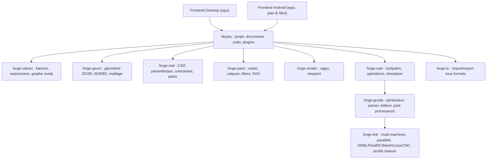
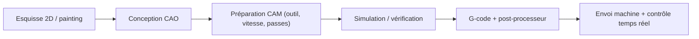

# Atelier de fabrication universel — Document de départ

> **Nom du projet :** **OmniFab**
>
> **Décisions validées :**
>
> - Noyau CAO : bindings **OpenCascade (OCCT)** ✓
> - Licence : **GPL-3.0+** ✓
> - Contrôleur machine prioritaire : **LinuxCNC** (multi-axes, changeur d'outils) ; GRBL/FluidNC ensuite ✓
> - Procédé pilote : **fraisage CNC 2,5D** ✓
> - Synchro ordinateur ↔ téléphone : **export/import manuel** (100 % local) ✓
> - Priorité : **workflow complet de A à Z** (cas d'école : fabriquer un meuble : CAO paramétrique → découpe/gravure 2D + raster → CAM → LinuxCNC) ✓
> - Interface : **egui** ✓ (preuve de concept Android dès le jalon 0, plan B = frontend mobile Slint sur le même noyau)
> - Extensions fonctionnelles validées : éditeur G-code multi-dialectes (colorisation, autocomplétion, aides), gestion multi-machines en parallèle, traitement par lots, bibliothèques de données réelles sourcées, assistant de profils machines et dialectes G-code maison, paramétrique universel (alias + nodal sur un moteur unique), assistants de conception guidée (guides pas-à-pas par type d'objet + éditeur de guides personnalisés), classification multi-référentielle des objets + nomenclatures/BOM paramétriques, interopérabilité openBIM (IFC à l'import, DSTV/NC1 à l'export), détection automatique des contrôleurs et bibliothèques de données « référence ouverte du marché » (vision 2026-10-19) ✓
>
> **Objectif de ce document :** contenir (A) le prompt à copier-coller dans une nouvelle discussion pour lancer la conception, et (B) les annexes de référence (stack, formats, architecture, interface, roadmap) pour valider et ajuster les choix avant et pendant cette discussion.
>
> **Dernière synchronisation : v4, 2026-10-26** (contrôle de cohérence hebdomadaire) — DWG en lecture (R13–2018), PSD/PSB round-trip avec préservation des calques (précédent PhotoCraft), formats broderie DST/JEF/PES, listes de logiciels harmonisées sur le KNOWLEDGE.md racine (matrice v8).

---

## Partie A — Le prompt à coller dans la nouvelle discussion

Copiez le bloc ci-dessous tel quel.

```text
RÔLE
Tu es architecte logiciel principal d'un projet libre d'envergure : une application
unique, modulaire et polyvalente qui remplace de A à Z les programmes nécessaires
pour concevoir et fabriquer des objets. Tu ne codes pas tout d'un coup : tu mènes
la conception par phases, en validant chaque brique avec moi avant de passer à la
suivante.

VISION
Une seule application qui couvre, sans sortir de l'outil :
1. Création graphique 2D : dessin vectoriel, retouche/painting raster, calques,
   traitement d'image, composition.
2. Conception type ingénieur : CAO 2D et 3D paramétrique, pièces, assemblages,
   mise en plan, contraintes et historique de construction (feature tree).
3. Fabrication : CFAO/CAM multi-procédés — CNC 3, 4 et 5 axes, fraisage 2,5D
   (prioritaire) puis fraisage 3D, tournage (tour numérique), découpe au
   couteau, découpe plasma, découpe laser, gravure laser, broderie
   (machine à broder numérique — DST/JEF/PES, comme Ink/Stitch) — avec
   post-processeurs, simulation/usinage virtuel, génération et vérification
   de G-code. Les images raster sont des sources à part entière : motifs à
   graver, heightmaps (cartes de niveaux pour reliefs), tracés vectorisés.
4. Éditeur et simulation G-code : éditeur intégré avec colorisation
   syntaxique et autocomplétion référencées sur le dialecte du contrôleur
   cible, aides à la modification (documentation des commandes en ligne,
   détection d'erreurs, aperçu de la trajectoire au curseur), simulateur
   d'usinage 3D.
5. Communication machine : envoi de G-code, contrôle temps réel, DRO, jog,
   palpage/sonde, broche/laser/plasma, changeur d'outils, retour d'état,
   journalisation ; gestion de PLUSIEURS MACHINES EN PARALLÈLE (file de
   travaux par machine, supervision simultanée). Contrôleurs : LinuxCNC
   prioritaire, dialectes GRBL/FluidNC/Marlin ensuite, et machines maison à
   base d'Arduino avec plusieurs moteurs via l'abstraction (axes multiples,
   options, extensions). Un assistant permet de créer des profils machines
   et des dialectes G-code maison (plusieurs firmwares). Liaisons physiques
   : PORT SÉRIE (USB pour contrôleurs modernes, RS-232 pour les machines
   anciennes) et PORT PARALLÈLE LPT pour piloter directement des machines
   pas-à-pas classiques (signaux step/dir sur les broches). DÉTECTION
   AUTOMATIQUE (2026-10-19) : minimiser la configuration — sondage des
   paramètres de communication (débits, bannières, empreintes protocolaires
   par dialecte) pour identifier automatiquement le contrôleur (type, marque,
   modèle) via la base communautaire ; profil proposé à validation, jamais
   de commande de mouvement pendant la sonde. Sur LinuxCNC,
   OmniFab peut REMPLACER l'interface Axis : soit comme GUI native déclarée
   dans l'INI ([DISPLAY] DISPLAY=omnifab, liaison NML), soit par pilotage
   distant via linuxcncrsh (réseau) ; dans les deux cas le noyau temps réel
   et le HAL restent gérés par LinuxCNC.
6. Paramétrique universel : TOUTE valeur du programme peut être liée à une
   autre (ex. : le nom d'un document pilote le module et le nombre de dents
   d'un engrenage), par alias/expressions ET par un système nodal type
   Xpresso (Cinema 4D) où l'on glisse une valeur depuis l'interface vers le
   graphe. Un MOTEUR UNIQUE de liaisons (graphe de dépendances réactif +
   expressions) alimente les deux interfaces : zéro incohérence possible.
7. Associativité complète : toutes les parties du logiciel sont connectées
   autour d'un modèle unique ; toute modification (ex. : une dimension) se
   propage à tout le workflow (la trajectoire de fraisage se régénère
   automatiquement).
8. Traitement par lots : à partir d'un fichier source (ex. : une image),
   générer autant de fichiers/jobs que nécessaire, avec des paramètres
   identiques ou variables selon la configuration du lot.
9. Bibliothèques de pré-réglages avec données réelles : matériaux (avances,
   vitesses de coupe, propriétés physiques réelles), types et marques de
   machines courantes (hobby et industriel, caractéristiques constructeurs),
   normes ISO (visserie, formats…). Sources : bases libres existantes,
   contributions communautaires, normes ISO ; toute donnée sourcée et citée,
   sous licence ouverte compatible GPL. VISION « RÉFÉRENCE DU MARCHÉ »
   (2026-10-19) : ces bibliothèques deviennent une infrastructure de données
   partagée pour l'industrie — accessibles et utilisables par des tiers et
   d'autres programmes, comme base de données de référence gratuite (modèle
   OpenStreetMap de la fabrication : format autonome documenté, accès triple
   par fichiers/API/crate, gouvernance neutre, identifiants stables, ODbL).
   Architecture à trois niveaux : (a) données descriptives embarquées dans
   l'installation (volumétrie Ko, hors ligne dès le premier lancement),
   incluant une ontologie à relations typées (compatibilités entre éléments :
   ex. pas de vis standard partagé entre visserie et quincaillerie) et des
   assemblages compositionnels (moteur, valve…) ; (b) géométrie GÉNÉRÉE depuis
   les valeurs pour les pièces décrites par une norme (visserie, profilés
   IPE/HEA/UPN, quincaillerie normée) par générateurs paramétriques — zéro
   stockage, cohérence par construction, toutes tailles disponibles ; (c)
   bibliothèque géométrique téléchargée à la demande (glTF LOD + STEP/3MF)
   pour les pièces non déductibles d'une norme, dépôt séparé, cache local.
   Règle de décision publiable : si une norme décrit la pièce → générée ;
   sinon → modèle téléchargé.
10. Interopérabilité : lecture/écriture des formats ouverts des logiciels de
   référence cités plus bas, sans perte inutile.
11. Aide contextuelle universelle : chaque option, bouton, paramètre et
   commande de l'interface est relié à sa documentation — clic droit sur
   l'élément → « Aide sur X » ouvre la page qui le décrit, avec des exemples
   concrets dans le contexte (valeurs réalistes, scénario pas à pas, images),
   et des liens vers les options liées.
12. Fabrication par tranches « 123D Make » : découper un objet 3D en gabarits
   2D usinables/découpables — tranches empilées, enchevêtrées par fentes,
   tranches courbes (conformes à la surface), tranches radiales, panneaux
   pliés — avec goupilles de positionnement et plans d'assemblage numérotés,
   pour matériaux plats (bois, carton, acrylique). Autodesk a abandonné
   l'outil ; aucun équivalent libre complet n'existe.
13. Sécurité pédagogique pendant le pilotage : avant lancement d'un job et
   pendant l'exécution, l'application explique les risques de l'action en
   cours (collision, dépassement de courses, broche en rotation, feed hold,
   arrêt d'urgence) ; tout contournement d'une protection demande une
   confirmation explicite.
14. Maintenabilité : documentation développeur de premier ordre (rustdoc sur
   toute API publique, ADR pour chaque décision, architecture vivante,
   guides d'extension) pour que le logiciel puisse être maintenu facilement
   par des développeurs qui n'ont pas écrit le code d'origine.
15. Assistants de conception guidée : pour chaque famille d'objets (meubles,
   escaliers, charpente, structures acier, cadres en tubes/profilés alu,
   tuyauterie…), un formulaire pas-à-pas génère un modèle paramétrique
   éditable, une nomenclature, une liste de débit et les fichiers CNC, avec
   des valeurs préenregistrées issues des normes du secteur (quincaillerie
   32 mm, formule de Blondel, sections normalisées, pentes de toit…), des
   contrôles de conformité, et la possibilité pour l'utilisateur de CRÉER
   SES PROPRES GUIDES (templates déclaratifs versionnés et partageables,
   sans coder) — à l'image de PolyBoard pour le meuble, étendu à tout type
   de construction.

PLATEFORMES
- Ordinateur : Linux (Ubuntu + cross-distribution), Windows. macOS non prioritaire.
- Mobile : Android (priorité). iOS hors périmètre pour l'instant.
- Exigences : un cœur unique partagé ; toutes les fonctionnalités disponibles sur
  ordinateur et sur mobile ; interfaces adaptées à chaque plateforme (bureau =
  espaces de travail denses et configurables, mobile = fonctions principales à
  l'écran, fonctions secondaires en menus).
- Interopérabilité ordinateur ↔ téléphone : même format de projet natif ;
  transfert par export/import manuel au départ (aucun service cloud requis).
- Extension future validée : version web (WebAssembly) à partir de la MÊME
  source — egui/eframe compile natif et wasm, wgpu bascule sur WebGPU/WebGL2.
  Non bloquante, mais trois règles d'architecture obligatoires dès le jalon 0 :
  (a) aucun accès « native only » (série, fichiers) hors d'un trait
  d'abstraction avec implémentations par plateforme ; (b) feature flags
  native/wasm dans les crates ; (c) la couche machine prévoit deux transports
  dès le départ : série natif et WebSocket (pont local pour le web, Web Serial
  API n'étant pas universelle). OCCT en wasm : compiler un sous-ensemble des
  modules nécessaires (une build complète ~50-70 Mo est trop lourde pour
  le web ; cf. opencascade.js).

CONTRAINTES TECHNIQUES (références imposées, à challenger avec justification)
- Langage principal : Rust (performances type C++, sécurité mémoire, maturité
  cross-platform desktop + Android).
- Rendu GPU : wgpu. Mathématiques : glam.
- Interface : **egui** (décision validée) — densité type Blender, viewport wgpu
  natif, licence MIT/Apache. Contrainte imposée : valider dès le jalon 0 une
  preuve de concept egui sur Android (tactile, clavier virtuel, cycle de vie
  de l'activité) ; si l'expérience est insuffisante, greffer un frontend
  mobile Slint sur le même noyau sans toucher au reste.
- Architecture : un « noyau » (workspace de crates Rust) sans dépendance à
  l'interface ; frontends desktop et Android fins au-dessus du noyau.
- Noyau CAO : bindings OpenCascade (occt, LGPL) — décision validée. Réalité
  terrain : les bindings Rust d'OCCT (opencascade-rs, occt-rs) sont en
  développement précoce, sans API stabilisée. Prévoir un jalon dédié de
  consolidation : reprendre un binding existant et le fiabiliser, ou wrapper
  ciblé via cxx. OCCT reste lié dynamiquement (exigence LGPL).
- Format de projet natif : conteneur ZIP (manifeste JSON versionné + un
  fichier par objet + blobs binaires pour maillages/images), à l'image des
  .FCStd / OpenDocument / 3MF. Champs « version » et outil de migration dès
  le jour 1. Débogable, extensible, archivable.
- Modèle de document : event sourcing — chaque opération utilisateur est un
  événement sérialisé et rejouable. Cela donne l'undo illimité, l'arbre des
  fonctions paramétrique et la reprise d'un projet sur un autre appareil.
- Liaisons paramétriques : moteur unique (graphe de dépendances réactif +
  expressions) au cœur du modèle de document, exposé par DEUX interfaces
  construites en parallèle : alias/expressions et éditeur nodal (glisser une
  valeur depuis l'UI vers le graphe, type Xpresso). Un seul moteur = aucune
  incohérence entre les deux vues ; s'intègre à l'event sourcing (une
  opération paramétrée est rejouable). C'est le sixième « verrou ».
- Contraintes 2D : réutiliser planegcs (le solveur de FreeCAD, LGPL) via FFI ;
  réécriture Rust éventuelle plus tard, à froid. Pas de solveur maison.
- Concurrence : tokio pour la communication machine, canaux entre la machine
  et l'UI, calculs géométriques en blocs parallélisés (jamais en async).
  Règle d'or : un freeze de l'interface ne coupe jamais le pilotage machine.
- Unités : newtypes stricts (longueur, angle…) dans toutes les API métier,
  jamais de f64 nu ; tolérance géométrique documentée (1e-6 mm par défaut).
- i18n : Fluent, toutes les chaînes derrière des clés dès le jalon 1.
- Aide intégrée : chaque élément d'interface porte un identifiant d'aide
  (help_id) dès le premier widget ; clic droit → « Aide sur X ». Le contenu
  d'aide est un ensemble de fichiers versionnés dans le dépôt, traduits via
  Fluent, rendus dans l'application ET réutilisables pour le manuel et le
  site web (source unique). Chaque page : description, paramètres, exemples
  concrets dans le contexte, liens vers options liées. L'aide est testée en
  CI : un widget sans help_id ou une page sans exemple échouent le build.
- Communication machine : bibliothèque série/réseau robuste + couche
  d'abstraction de contrôleurs (GRBL, FluidNC, LinuxCNC…). Liaisons
  physiques : (a) PORT SÉRIE — USB série pour les contrôleurs modernes,
  RS-232 pour les machines anciennes (transfert de fichiers + DNC « drip
  feed » : les contrôleurs vintage ont très peu de RAM, le G-code est
  envoyé au fil de l'exécution ; bauds/parité/handshake configurables) ;
  (b) PORT PARALLÈLE LPT — pilotage direct des machines pas-à-pas
  classiques par signaux step/dir sur les broches, à la manière du driver
  parport de LinuxCNC et de Mach3 historiquement ; ce mode exige un noyau
  Linux temps réel et un port LPT natif ou une carte PCIe (les adaptateurs
  USB-parallèle sont inutilisables pour le step/dir à cause de leur
  latence) ; (c) WebSocket pour la cible web. Multi-machines en
  parallèle : plusieurs machines simultanément, une file par machine.
- Sécurité pendant le contrôle : alertes pédagogiques intégrées — avant
  lancement d'un job et pendant l'exécution, l'application explique les
  risques de l'action en cours (collision, dépassement de courses, broche en
  rotation, feed hold à distance, arrêt d'urgence) ; tout contournement
  demande une confirmation explicite.
- Extensions : système de plugins isolés (WASM ou chargeur de modules) pour
  filtres, post-processeurs, matériaux.
- Pas de service cloud obligatoire : l'application doit fonctionner 100 % en
  local ; le réseau ne sert qu'à la communication machine et à la synchro
  optionnelle entre appareils.

LOGICIELS DE RÉFÉRENCE (s'inspirer du comportement et des formats, code sous
licence libre : FreeCAD, Blender, Inkscape, Krita, GIMP, GMIC, Graphite,
LinuxCNC (dont PlasmaC/QtPlasmaC pour le plasma), Camotics, bCNC, KiriMoto,
LaserGRBL, Universal G-Code Sender, FluidNC, gSender, LaserWeb, FabexCNC,
BlenderCAM, F-Engrave (gravure V), Ezilathe (tournage), Deepnest/SVGnest
(nesting), FlatCAM + pcb2gcode (PCB), SolveSpace, OpenSCAD, InkCut (traceurs
2D), CNCjs, QCAD, MeshLab, Ink/Stitch (broderie), PyCAM, PrusaSlicer/Cura
(impression), mods du MIT CBA (chaînes de fabrication nodales), BOSL2
(bibliothèques paramétriques), WikiHouse (système constructif libre),
FullControl (design direct de trajectoires en G-code), la suite ArtCraft
(VectorCraft, CADCraft, PhotoCraft, GridCraft — libres en Rust natif), ainsi
que la famille G-code (RS-274 / dialectes LinuxCNC et GRBL).

INSPIRATIONS COMMERCIALES (comportement et workflows uniquement, jamais le
code — pour rester 100 % libre GPL) : Vectric (VCarve/Aspire : gravure V,
inlays), SheetCam (plasma : kerf, lead-in/out, cut charts), Fusion 360
(intégration CAO+CFAO, 3+2 positionnel), Mastercam, SolidWorks et SolidWorks
CAM (configurations, reconnaissance automatique de fonctions, usinage piloté
par les tolérances), 3DEXPERIENCE CATIA (knowledgeware, Class-A), Siemens NX,
Onshape, Alibre, LightBurn (laser), MeshCAM (CAM sans CAO), Edgecam ; et les
spécialistes par type de construction pour l'axe « assistants de conception
guidée » : PolyBoard (meubles), StairDesigner (escaliers), SketchList
(meubles), Cadwork/Dietrich's/sema (charpente), Advance Steel/Tekla
(structures acier), MTpro (profilés alu) ; et le monde BIM pour la
classification et l'interopérabilité : Autodesk Revit / Graphisoft Archicad
(classification multi-référentielle OmniClass/Uniclass/UniFormat,
nomenclatures/BOM paramétriques), écosystème openBIM buildingSMART (IFC,
BCF, IDS).

EXIGENCE D'EXHAUSTIVITÉ : en phase 0, produire un inventaire complet des
fonctionnalités de CHACUN de ces logiciels de référence, classé dans une
matrice « fonctionnalité × logiciel » : aucune capacité majeure ne doit
manquer à OmniFab. Fusionner les doublons, conserver les fonctions propres à
chaque logiciel comme options avancées. Cet inventaire alimente la matrice
formats/interopérabilité et la définition des jalons.

FORMATS À SUPPORTER (priorité ouverte/standard)
- Vectoriel 2D : SVG, DXF, DWG (lecture, R13–2018 — précédent récent CADCraft,
  crate réutilisable à évaluer), PDF (import).
- CAO : STEP, IGES, BREP ; natif FreeCAD (.FCStd) à l'import ; IFC à l'import
  (maquettes BIM : pièces/sous-modèles réutilisables pour la fabrication,
  chaîne BIM → CAM).
- Maillage 3D : STL, 3MF, OBJ, PLY, glTF ; natif Blender (.blend) à l'import.
- Image : PNG, JPEG, TIFF, WebP, EXR ; OpenRaster (.ora), .kra (Krita), .psd
  et .xcf à l'import ; PSD/PSB round-trip avec préservation des calques
  (précédent PhotoCraft) ; filtres GMIC (.gmic).
- Fabrication : G-code (généré + lu, dialectes GRBL/FluidNC/LinuxCNC), fichiers
  projets CAM ; enregistrer les paramètres d'usinage dans le projet natif ;
  DSTV/NC1 (pièces acier vers machines CNC, interface neutre standard).
- Broderie : DST/JEF/PES (export, comme Ink/Stitch).
- Classification et nomenclatures : les objets peuvent porter des codes de
  plusieurs référentiels simultanément (classification à la BIM : OmniClass,
  Uniclass, UniFormat ; normes mécaniques ISO ; bibliothèques maison),
  conditionnant la disponibilité des propriétés ; nomenclatures/BOM
  paramétriques recalculées en direct depuis le modèle, export tableur.
- Projet natif : format document unique (conteneur document, historique,
  paramètres machine), versionné et documenté publiquement.

LOGICIEL LIBRE
- Licence : GPL-3.0 ou ultérieure (compatible avec Blender, Inkscape, GIMP,
  Krita, FreeCAD — les licences MPL-2.0/Apache-2.0 seront utilisées pour les
  bibliothèques isolées réutilisables).
- Développement : dépôt public, README/CONTRIBUTING, CI multi-plateformes,
  tests, documentation d'architecture à jour.
- MAINTENABILITÉ (exigence de premier ordre, au même niveau que les
  fonctionnalités) : le projet doit pouvoir être maintenu par des
  développeurs qui n'ont pas écrit le code. Concrètement : rustdoc
  obligatoire sur toute API publique (les docs sont publiées et testées en
  CI), un dossier docs/adr/ d'Architecture Decision Records (chaque choix
  technique tranché = un ADR avec alternatives rejetées), une documentation
  d'architecture vivante (schéma des crates, flux de données, invariants du
  modèle event sourcing, conventions de nommage/erreurs), des exemples
  d'utilisation par crate, un guide « comment ajouter un procédé / un
  dialecte / un format » (les trois axes d'extension les plus probables),
  et des messages d'erreur exploitables (codes d'erreur typés, jamais de
  panique silencieuse). La CI vérifie la couverture de documentation ; une
  API publique sans doc échoue le build, comme un widget sans help_id.

MÉTHODE DE TRAVAIL ATTENDUE
1. Phase 0 — Cadrage : pose-moi d'abord tes questions de clarification, puis
   propose l'architecture cible (schéma du workspace de crates, frontends,
   flux de données, arbre de dépendances) et la liste tranchée des choix
   techniques avec justifications. Ne code pas avant validation.
2. Ensuite, par jalons incrémentaux, un module à la fois, chacun livré avec :
   spécification courte, squelette de crate compilable, tests minimaux,
   exemple d'utilisation.
3. Ordre de jalons (à affiner avec moi) : livrer une « tranche horizontale »
   de bout en bout dès que possible — cas d'école : concevoir un meuble
   (CAO paramétrique contrainte), générer découpes et gravures (2D vectoriel
   + raster/heightmap), préparer les trajectoires de fraisage 2,5D, simuler,
   puis piloter la machine via LinuxCNC. Ensuite élargir : multi-axes,
   changeur d'outils, tournage, laser, painting complet, plugins, Android.
4. À chaque étape : point sur la dette technique, les risques, et ce qui peut
   être réutilisé de bibliothèques existantes plutôt que réécrit.

TON PREMIER LIVRABLE DANS CETTE DISCUSSION
Un document d'architecture (ADR nº 0) : vision, choix techniques tranchés avec
alternatives rejetées, diagramme du workspace, matrice formats prioritaires,
et plan des 5 premiers jalons. Puis attends ma validation.
```

---

## Partie B — Annexes de référence

### B1. Stack technique recommandé


| Couche                   | Recommandation                                                | Alternative                    | Justification                                                                                                     |
| ------------------------ | ------------------------------------------------------------- | ------------------------------ | ----------------------------------------------------------------------------------------------------------------- |
| Langage cœur             | Rust                                                          | C++ (héritage des libs CAO)    | Perf + sécurité + Android natif ; cohérent avec Graphite (référence Rust)                                         |
| Rendu GPU                | wgpu                                                          | glow (OpenGL)                  | Standard de fait, Vulkan/Metal/GL/WebGPU                                                                          |
| UI desktop + mobile      | egui                                                          | Slint                          | egui : densité type Blender, wgpu natif — Slint : meilleur Android natif. Décision finale en phase 0 (voir B1bis) |
| Maths / géométrie        | glam, curves/para-geom                                        | cgmath                         | Écosystème de référence                                                                                           |
| Noyau CAO                | Bindings OpenCascade (LGPL)                                   | Noyau maison                   | CAO paramétrique solide = années de travail ; OCCT éprouvé (même base que FreeCAD)                                |
| Maillage                 | parry3d, meshopt                                              | half-edge maison               | Collisions, optimisation, simplification                                                                          |
| Images / painting        | image, rustybuzz, vello (SVG)                                 | —                              | Vello = moteur SVG vector-GPU (projet Rust officiel)                                                              |
| Traitement d'image       | Réseau de filtres + bindings GMIC                             | Noyau maison                   | GMIC référence imposée                                                                                            |
| G-code                   | Parser/générateur maison + dialectes                          | Bindings libs C                | Grammaire simple, contrôle total des dialectes                                                                    |
| Communication machine    | serialport + tokio                                            | —                              | Série USB, TCP, async robuste                                                                                     |
| Plugins                  | WASM (wasmtime)                                               | Modules dynamiques             | Isolation, sécurité, cross-platform                                                                               |
| Synchro desktop ↔ mobile | Fichier projet versionné + export/import, puis synchro locale | Serveur cloud                  | 100 % local d'abord                                                                                               |
| Licence projet           | GPL-3.0+                                                      | MPL-2.0 pour les crates isolés | Compatibilité max avec les logiciels de référence                                                                 |


### B1bis. Comparaison des frameworks d'interface (décision en phase 0)


| Critère                        | Slint | egui | Flutter + Rust |
| ------------------------------ | ----- | ---- | -------------- |
| Densité UI type Blender        | 3/5   | 5/5  | 4/5            |
| Maturité Android               | 4/5   | 3/5  | 5/5            |
| Intégration wgpu (viewport 3D) | 4/5   | 5/5  | 2/5            |
| Base de code unique            | 5/5   | 5/5  | 2/5            |
| Liberté de licence             | 3/5   | 5/5  | 5/5            |
| Écosystème et communauté       | 3/5   | 4/5  | 5/5            |


- **Slint** — ✅ déclaratif (fichiers `.slint` à part, séparation UI/logique), support Android et embarqué très abouti, rendu GPU natif, animations propres. ❌ dual-licence (GPLv3 OU commerciale : toute bibliothèque liée doit être compatible GPL), interfaces denses multi-panneaux plus laborieuses qu'en immediate mode, intégration d'un viewport wgpu custom possible mais moins directe.
- **egui** — ✅ pur Rust, immédiat, parfait pour les interfaces denses type Blender (dockers, panneaux flottants), **construit sur wgpu** (viewport 3D trivial), licence MIT/Apache, adopté par l'écosystème CAO/graphique Rust. ❌ Android fonctionnel mais moins mature (clavier virtuel, cycle de vie, perfs tactiles), rétention d'état à gérer soi-même, look « immédiat » moins natif.
- **Flutter + bindings Rust** — ✅ le plus mature sur Android, widgets impeccables, communauté énorme. ❌ deux mondes à maintenir (Dart + Rust via flutter\_rust\_bridge), intégrer un viewport wgpu dans le rendu Flutter est difficile et coûteux, projet 100 % Rust impossible.
- **Hybride egui (desktop) + Slint (mobile)** : possible car le noyau est séparé, mais double travail d'UI — à considérer seulement si egui s'avère insuffisant sur Android en pratique.

**Décision finale (validée) : egui** — densité type Blender native, viewport wgpu partagé, un seul langage pour la communauté, licence MIT/Apache sans ambiguïté. Filet de sécurité : le noyau reste strictement découplé ; preuve de concept Android au jalon 0 ; bascule possible vers un frontend mobile Slint sans recommencer le cœur.

### B2. Architecture modulaire (workspace de crates)



### B3. Flux de production A → Z



### B4. Matrice formats &amp; interopérabilité


| Domaine                | Formats                                 | Logiciel de référence         |
| ---------------------- | --------------------------------------- | ----------------------------- |
| Vectoriel 2D           | SVG, DXF, DWG (lecture), PDF             | Inkscape, FreeCAD TechDraw ; CADCraft (DWG) |
| CAO solide             | STEP, IGES, BREP, FCStd, IFC (import)  | FreeCAD ; Revit/ArchiCAD (IFC) |
| Maillage 3D            | STL, 3MF, OBJ, PLY, glTF, blend         | Blender, FreeCAD              |
| Image raster           | PNG, JPEG, TIFF, WebP, EXR, PSD, XCF    | GIMP, Krita                   |
| Document image calques | OpenRaster (.ora), .kra                 | Krita, GIMP                   |
| Filtres                | .gmic                                   | GMIC                          |
| Graphes nodaux         | Conception type Graphite/Blender nodes  | Graphite, Blender             |
| Fabrication            | G-code GRBL/FluidNC/LinuxCNC, toolpaths, DSTV/NC1 (pièces acier → CNC) | LinuxCNC, bCNC, UGS, gSender, Tekla/Advance Steel |
| Classification / nomenclatures | Codes multi-référentiels (OmniClass, Uniclass, UniFormat, ISO, maison) + BOM paramétriques | Revit, Archicad, Tekla       |
| Simulation usinage     | Rejouage G-code 3D                      | Camotics, BlenderCAM          |
| Laser / plasma / couteau | G-code GRBL, paramètres laser/plasma, commandes tangentielles | LaserGRBL, LaserWeb, FabexCNC |
| Broderie               | DST, JEF, PES (export)                 | Ink/Stitch                    |


### B5. Concept d'interface à envisager ensemble

**Desktop** — espaces de travail commutables (comme Blender) : *Conception 2D*, *CAO 3D*, *CAM*, *Atelier machine*, *Painting*. Panneaux ancrables, viewport central, arbre de projet commun à tous les ateliers.

```text
┌────────────────────────────────────────────────────────────┐
│ Menu │ [2D] [CAO] [CAM] [MACHINE] [PAINT]   ▸ espace actif  │
├──────┬──────────────────────────────────┬──────────────────┤
│ Arbre│                                  │ Propriétés /     │
│ pro- │        VIEWPORT (wgpu)           │ opérateurs       │
│ jet  │                                  │ (contextuel)     │
│      │                                  │                  │
├──────┴──────────────────────────────────┴──────────────────┤
│ Chronologie / historique │ Console G-code / DRO machine    │
└────────────────────────────────────────────────────────────┘
```

**Android** — même noyau, fonctionnalités principales plein écran, fonctions secondaires en menus déroulants/tiroirs ; onglets bas d'écran : *Projets*, *Créer*, *Fabriquer*, *Machine* ; mode « télécommande d'atelier » (DRO, jog, arrêt d'urgence, suivi de job) utilisable à côté de la machine.

### B6. Roadmap progressive (jalons)


| Jalon | Contenu                                                                                                           | Sortie visible                            |
| ----- | ----------------------------------------------------------------------------------------------------------------- | ----------------------------------------- |
| 0     | Architecture, choix tranchés, squelette workspace + preuve de concept egui sur Android (tactile, clavier virtuel) | Document ADR + repo compilable + APK démo |
| 1     | Noyau projet + undo + import/export SVG/DXF/STL + help_id sur toute l'UI + système d'aide                                  | Ouvrir/sauver un projet                   |
| 2     | Viewport wgpu + esquisse 2D contrainte + moteur de liaisons (alias/expressions)                                  | Dessiner dans l'app                       |
| 3     | CAO paramétrique (extrusion, répétitions, plans) + éditeur nodal de valeurs (type Xpresso)                        | Pièce simple de A à dessin                |
| 4     | CAM 2,5D + multi-procédés (3/4/5 axes, tour, couteau, plasma, laser) + éditeur G-code + simulateur                | Usinage virtuel complet                   |
| 5     | forge-link : LinuxCNC prioritaire (DRO, jog, palpage, multi-axes) + gestion multi-machines en parallèle           | Premier objet réel fabriqué               |
| 6     | Painting raster + calques + filtres                                                                               | Retouche image dans l'app                 |
| 7     | Android (même noyau, UI adaptée)                                                                                  | Version mobile                            |
| 8     | Plugins WASM + communauté                                                                                         | Écosystème                                |
| 9     | Cible web (WASM) : même noyau, egui/eframe web, pont machine WebSocket                                            | Version navigateur                        |
| 10    | Traitement par lots + bibliothèques de pré-réglages (matériaux, machines, normes ISO) + assistant de profils/dialectes maison + éditeur d'assistants de conception guidée | Fabrication en série prête à l'emploi     |


### B7. Normes open source

- **Licence** : GPL-3.0+ pour l'application ; MPL-2.0/Apache-2.0 pour les crates isolés réutilisables.
- **Gouvernance** : dépôt public (GitLab/GitHub/Codeberg), CONTRIBUTING, code of conduct, ADR (architecture decision records) pour chaque choix structurant.
- **CI** : builds Linux (x86\_64 + aarch64), Windows, Android (APK), tests + clippy + fmt à chaque commit.
- **Compatibilité communautés** : formats documentés, scripts d'import testés contre des fichiers réels produits par les logiciels de référence.

---

## Prochaines itérations possibles de ce document

- ~~Choisir le nom définitif~~ → **OmniFab** ✓
- ~~Arbitrer Slint vs egui vs Flutter~~ → **egui** ✓
- ~~Cinq verrous techniques~~ → ZIP + event sourcing + planegcs + tokio + unités strictes ✓
- Spécifier le **schéma du manifeste** du conteneur ZIP (détaillé en phase 0).
- Rédiger les **spécifications du protocole machine** (états LinuxCNC en priorité, puis GRBL/FluidNC).
- ~~Ébaucher la matrice « fonctionnalité × logiciel de référence »~~ → **v8** dans le document séparé « Matrice fonctionnalité × logiciel » (~277 fonctions, 10 domaines, §10 extensions, §11 assistants de conception guidée, classification/openBIM en transversal) — enrichie par 9 cycles de recherche (~60 logiciels libres et commerciaux ; la v8 fusionne les trains d'ajouts « bibliothèques » du 2026-10-19 et ArtCraft/FullControl du 2026-10-24).
- Préparer une **maquette interactive d'interface** pour valider l'ergonomie desktop/mobile avant le développement.